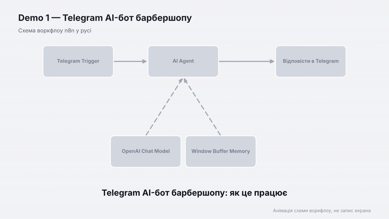

# Demo 1 — Telegram AI-бот барбершопу

Бот-адміністратор вигаданого барбершопу «Фейд». Відповідає українською на питання про ціни, години роботи й адресу, збирає дані для запису (ім'я, послуга, дата, час) та пам'ятає останні 10 повідомлень розмови.

Відео: [demo.mp4](demo.mp4) · Схема: [schema.png](schema.png)

## Як це працює

1. **Telegram Trigger** отримує повідомлення клієнта.
2. **AI Agent** з моделлю OpenAI (gpt-4o-mini) формує відповідь за системним промптом, у якому описані послуги, ціни та правила.
3. **Window Buffer Memory** зберігає контекст розмови окремо для кожного чату (за chat id).
4. Вузол **Telegram** надсилає відповідь клієнту.

## Що потрібно

- Telegram-бот: створи через @BotFather і збережи токен.
- OpenAI API-ключ.
- n8n із публічною HTTPS-адресою (n8n cloud, або локально через тунель, наприклад ngrok).

## Налаштування

1. Імпортуй `workflow.json`.
2. У вузлах **Telegram Trigger** і **Відповісти в Telegram** обери Telegram credential.
3. У вузлі **OpenAI Chat Model** обери OpenAI credential.
4. За потреби зміни дані барбершопу в системному промпті вузла **AI Agent**.
5. Натисни **Activate** і напиши боту в Telegram.

## Обмеження та ідеї для покращення

- Бот обробляє лише текстові повідомлення. Стікери й фото поки що не підтримуються.
- Дані для запису не зберігаються в таблицю, їх можна додати окремим вузлом.
- Можна додати кнопки вибору послуги.
