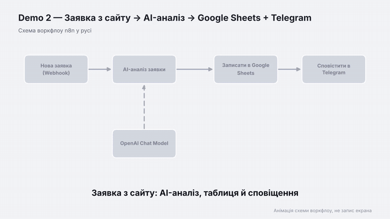

# Demo 2 — Заявки з сайту: AI-аналіз, Google Sheets і Telegram

Воркфлоу приймає заявку з форми сайту, за допомогою AI визначає категорію й пріоритет, готує чернетку відповіді клієнту, записує все в Google Sheets і надсилає менеджеру сповіщення в Telegram.



Відео: [demo.mp4](demo.mp4) · Схема: [schema.png](schema.png)

## Як це працює

1. **Webhook** отримує POST-запит із полями `name`, `phone`, `message`.
2. **AI-аналіз заявки** (LLM Chain з OpenAI) визначає категорію, пріоритет і пише чернетку відповіді.
3. **Google Sheets** додає новий рядок із даними заявки та AI-аналізом.
4. **Telegram** надсилає менеджеру повідомлення зі всією інформацією.

## Що потрібно

- Google-таблиця із заголовками в першому рядку: `Дата`, `Ім'я`, `Телефон`, `Повідомлення`, `AI-аналіз`.
- Telegram-бот (токен із @BotFather) і твій chat_id.
- OpenAI API-ключ.

## Налаштування

1. Імпортуй `workflow.json`.
2. У вузлі **Записати в Google Sheets** підключи акаунт і вибери свою таблицю та аркуш.
3. У вузлі **Сповістити в Telegram** вибери credential і заміни `ВСТАВ_СВІЙ_CHAT_ID` на свій chat_id.
4. У вузлі **OpenAI Chat Model** вибери OpenAI credential.

## Перевірка

Скопіюй Production URL вебхука й надішли тестову заявку (після активації воркфлоу):

```bash
curl -X POST <URL> \
  -H "Content-Type: application/json" \
  -d '{"name":"Оля","phone":"+380501234567","message":"Скільки коштує сайт-візитка?"}'
```

Для тесту без активації використовуй Test URL і кнопку **Execute workflow**.

## Ідеї для покращення

- Автоматична відповідь клієнту на пошту.
- Окрема гілка для заявок із високим пріоритетом.
- Перевірка формату телефону перед обробкою.
