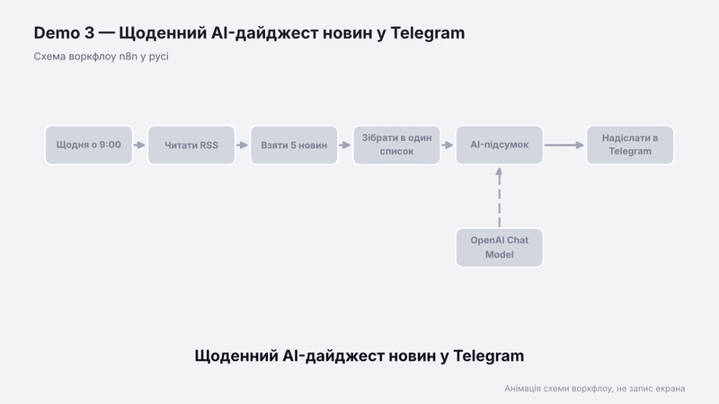

# Demo 3 — Щоденний AI-дайджест новин у Telegram

Щоранку о 9:00 воркфлоу бере п'ять новин із RSS-стрічки, AI коротко переказує кожну українською, і дайджест приходить у Telegram.

Відео: [demo.mp4](demo.mp4) · Схема: [schema.png](schema.png)

## Як це працює

1. **Schedule Trigger** запускає воркфлоу щодня о 9:00.
2. **RSS Read** читає стрічку (за замовчуванням `https://hnrss.org/frontpage`).
3. **Limit** залишає п'ять перших новин.
4. **Aggregate** збирає їх в один список.
5. **AI-підсумок** (LLM Chain з OpenAI) пише короткий переказ кожної новини українською.
6. **Telegram** надсилає дайджест.

## Що потрібно

- Telegram-бот (токен із @BotFather) і твій chat_id.
- OpenAI API-ключ.

## Налаштування

1. Імпортуй `workflow.json`.
2. Підключи Telegram і OpenAI credentials.
3. У вузлі **Надіслати в Telegram** заміни `ВСТАВ_СВІЙ_CHAT_ID` на свій chat_id.
4. За потреби заміни адресу RSS у вузлі **Читати RSS** на потрібне джерело.
5. Спершу натисни **Execute workflow** для ручної перевірки, потім **Activate**.

## Ідеї для покращення

- Кілька джерел новин в одному дайджесті.
- Вибір тем користувачем через команди Telegram-бота.
- Збереження архіву дайджестів у Google Sheets.
